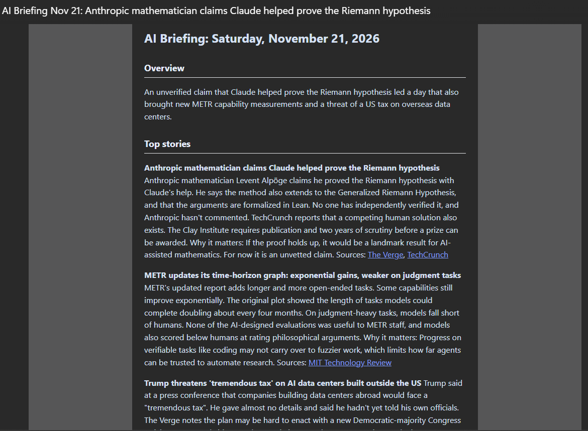
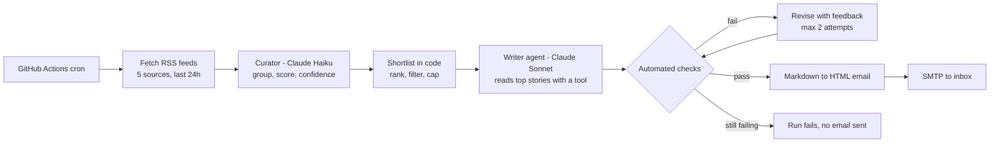

# AI News Digest Agent

A scheduled agent that reads AI news every morning and emails a short, sourced briefing.



See a full example in [docs/sample-digest.md](docs/sample-digest.md).

## What it does

Every day, GitHub Actions runs a pipeline that:

1. Fetches the last 24 hours of posts from 5 RSS feeds (Hugging Face, MIT Technology Review, TechCrunch AI, The Verge AI, OpenAI).
2. Uses Claude Haiku to group duplicate coverage, score each story's significance for a defined reader, and rate how well-confirmed it is.
3. Builds a ranked shortlist in code (score cutoff, story cap, deterministic tie-break).
4. Runs a Claude Sonnet writer agent that reads the top stories in full through a `read_article` tool and writes the briefing.
5. Validates the draft with automated checks and asks the model to fix any problems.
6. Sends the result as an HTML email.

## Architecture



## Design decisions

- **Pipeline plus an agent loop, not one big agent.** Fetching, filtering, and ranking cutoffs are deterministic code. The agent loop is used only where the model benefits from choosing: which articles to read in depth.
- **Model routing.** The cheaper model does bulk judgment over ~50 items; the stronger model writes the final text.
- **Significance and confidence are scored separately.** An early version capped unverified claims at a low score, which buried the biggest story of the day. Splitting "how important if true" from "how well confirmed" fixed it.
- **Structured output through a tool schema, validated in code.** The curator must return typed JSON, and code checks that every item is accounted for.
- **Checks live in code, not prompts.** Models cannot reliably count words, so length, link grounding (every link must come from the retrieved data), coverage, label leaks, and required sections are verified programmatically, with a bounded self-correction loop.
- **Least privilege.** The writer agent only has the `read_article` tool.
- **Untrusted content.** Article text is treated as data, never as instructions, and HTML is escaped before it reaches the email.
- **Failure behavior.** One broken feed degrades gracefully, all feeds failing fails the run, a digest that fails checks is not sent, and a token budget caps each run.

## Measured numbers

- About 45 seconds per run in GitHub Actions
- About 15,000 to 19,000 tokens per run (one Haiku call and two to three Sonnet calls)
- 5 sources and 5 automated output checks

## Setup

```bash
git clone https://github.com/YOUR-USERNAME/ai-news-agent.git
cd ai-news-agent
python -m venv .venv
source .venv/bin/activate        # Windows: .venv\Scripts\Activate.ps1
pip install -r requirements.txt
cp .env.example .env             # then fill in the values
python src/main.py               # dry run, writes data/digest.html
python src/main.py --send        # also emails the digest
```

| Variable | Purpose |
|---|---|
| `ANTHROPIC_API_KEY` | Claude API key |
| `EMAIL_SENDER` | Gmail address that sends the digest |
| `EMAIL_APP_PASSWORD` | Gmail app password (requires 2-Step Verification) |
| `EMAIL_RECIPIENT` | Where the digest is delivered |

Flags: `--hours N` (look back further), `--writer-only` (reuse the saved shortlist), `--send` (email the result).

For scheduled runs, add the same four values as GitHub Actions secrets.

## Project structure

```
src/
  tools.py     RSS fetching and the read_article tool, plus the tool dispatcher
  curate.py    Haiku curation step with structured output
  agent.py     reusable agent loop, final-step handling, revision call
  checks.py    automated validation of the digest
  emailer.py   Markdown to HTML conversion and SMTP delivery
  usage.py     token tracking and budget guard
  main.py      pipeline entry point
.github/workflows/daily-digest.yml
```

## Limitations and next steps

- Sources are limited to RSS feeds, and summaries are short unless an article can be fetched.
- Summaries are AI-written. Links are verified against retrieved data, but facts are only as good as the sources, so check the originals.
- GitHub's scheduler is best-effort and runs can be delayed.
- There is no automated evaluation of curation quality yet. A frozen, labeled test set for the curator is the planned next step.

## License

MIT